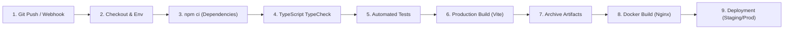

# دليل أتمتة DevOps باستخدام جنكينز (Jenkins CI/CD Pipeline Guide)

دليل شامل لكيفية إعداد وتشغيل مسار الأتمتة والتكامل المستمر والنشر المستمر (**CI/CD DevOps Pipeline**) لمنصة **بسطية (Bastiyah / Nexus Store)** باستخدام **Jenkins** و **Docker**.

---

## 🏗️ نظرة عامة على معمارية خط الأنابيب (Pipeline Overview)

تم إعداد خط أنابيب تصريحي احترافي معتمد على معايير DevOps العالمية عبر ملف [`Jenkinsfile`](./Jenkinsfile) في جذر المشروع:



---

## 📋 مراحل خط الأنابيب (Pipeline Stages)

| المرحلة | الوصف | الأمر المنفذ |
| :--- | :--- | :--- |
| **1. Checkout & Env** | استنساخ أحدث كود وفحص بيئة العمل وإصدارات الأدوات | `git log`, `node -v`, `npm -v` |
| **2. Install Dependencies** | تثبيت الاعتماديات بسرعة وبشكل نظيف عبر التخزين المؤقت | `npm ci --prefer-offline` |
| **3. Type Checking** | التحقق الصارم من صحة أنواع TypeScript وعدم وجود أي أخطاء | `npm run typecheck` (`tsc --noEmit`) |
| **4. Automated Tests** | تشغيل اختبارات توجيه روابط المتاجر واختبارات مزامنة العملاء الموحدة | `npm test` |
| **5. Security Audit** | (اختياري) فحص الثغرات الأمنية في حزم npm | `npm audit --audit-level=critical` |
| **6. Build Bundle** | بناء حزم الإنتاج المصغرة والمحسنة عبر Vite و Tailwind | `npm run build` |
| **7. Archive Artifacts** | أرشفة مجلد `dist/` داخل Jenkins لإمكانية تحميله مباشرة | `archiveArtifacts 'dist/**'` |
| **8. Docker Package** | بناء صورة Docker متعددة المراحل مبنية على Nginx خفيف وسريع | `docker build -t bastiyah/nexus-store .` |
| **9. Deployment** | النشر التلقائي للبيئة المحددة (`staging` أو `production`) | نصوص النشر المخصصة |

---

## 🚀 تشغيل Jenkins محلياً بواسطة Docker Compose

إذا لم يكن لديك خادم Jenkins جاهز، يمكنك تشغيل Jenkins محلياً في ثوانٍ عبر Docker:

```bash
# تشغيل خادم جنكينز في الخلفية
docker compose -f jenkins/docker-compose.jenkins.yml up -d

# متابعة السجلات للحصول على كلمة المرور الأولية (Initial Admin Password)
docker logs -f bastiyah_jenkins
```

ثم افتح المتصفح على: **`http://localhost:8080`**

للحصول على كلمة المرور الأولية لفك قفل جنكينز:
```bash
docker exec -it bastiyah_jenkins cat /var/jenkins_home/secrets/initialAdminPassword
```

---

## ⚙️ خطوات ربط المشروع في جنكينز (Setup Steps in Jenkins)

### 1. تثبيت الإضافات المقترحة (Suggested Plugins)
عند فتح جنكينز لأول مرة، اختر **"Install suggested plugins"**، وتأكد من تثبيت:
- **Pipeline**
- **Git Plugin**
- **Docker Pipeline**
- **AnsiColor** (لتلوين مخرجات التيرمنال)

### 2. إنشاء مهمة مسار الأنابيب (Create Pipeline Job)
1. من لوحة جنكينز الرئيسية، اضغط على **"New Item"**.
2. أدخل اسم المهمة: `bastiyah-cicd`.
3. اختر نوع: **"Pipeline"** (أو **"Multibranch Pipeline"** لدعم عدة فروع تلقائياً)، ثم اضغط **OK**.

### 3. إعداد مصدر الكود (Pipeline Configuration)
1. في قسم **Pipeline**:
   - اختر **Definition**: `Pipeline script from SCM`.
   - اختر **SCM**: `Git`.
   - أدخل **Repository URL**: `https://github.com/o-obahaa/bastiyah.git`.
   - في خانة **Branch Specifier**: اكتب `*/main` (أو دعها فارغة للمتعدد).
   - في خانة **Script Path**: تأكد من أنها `Jenkinsfile`.
2. اضغط **Save**.

### 4. إعداد الويب هوك للتشغيل التلقائي (GitHub Webhook Trigger)
لتشغيل الـ Pipeline تلقائياً مع كل `git push`:
1. في إعدادات المهمة بجنكينز، فعّل خيار: **"GitHub hook trigger for GITScm polling"**.
2. في مستودع GitHub (`Settings` -> `Webhooks` -> `Add webhook`):
   - **Payload URL**: `http://YOUR-JENKINS-SERVER:8080/github-webhook/`
   - **Content type**: `application/json`
   - **Events**: اختر `Just the push event`.

---

## 🐳 تشغيل المشروع كحاوية Docker مباشرة

تم إعداد [`Dockerfile`](./Dockerfile) متعدد المراحل فائق السرعة وخفيف الحجم مبني على Nginx:

```bash
# بناء صورة الدوكر
docker build -t bastiyah-store:latest .

# تشغيل الحاوية على المنفذ 80 (أو أي منفذ تختاره)
docker run -d -p 80:80 --name bastiyah-container bastiyah-store:latest
```

أو تشغيله بواسطة Docker Compose:
```bash
docker compose up -d --build
```
ثم افتح: **`http://localhost`**

---

## 🛠️ الأوامر المتاحة في المشروع

```bash
# فحص سلامة الأنواع
npm run typecheck

# تشغيل حزمة الاختبارات
npm test

# بناء حزمة الإنتاج
npm run build

# تشغيل سيرفر المعاينة
npm run preview
```
