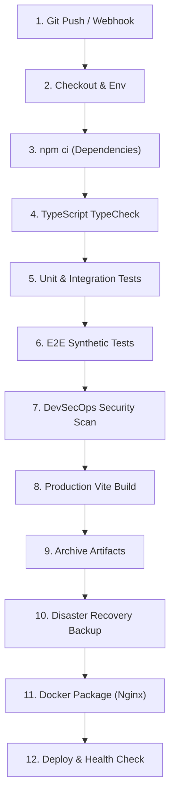

# دليل منظومة DevOps المتكاملة لمنصة بسطية (Bastiyah Enterprise DevOps Suite)

دليل شامل لكيفية استخدام وإدارة منظومة **DevOps** المتكاملة لمنصة **بسطية (Bastiyah)**، والتي تشمل أتمتة خط الأنابيب (CI/CD)، الحماية من الثغرات، إدارة النطاقات والشهادات، رصد الأخطاء المباشر، الاختبارات الشاملة، المراقبة المستمرة، والنسخ الاحتياطي السحابي.

---

## 🏗️ معمارية خط الأنابيب الموسّع (Enterprise Pipeline Architecture)

يعتمد خط أنابيب [`Jenkinsfile`](./Jenkinsfile) التصريحي على 12 مرحلة متسلسلة لضمان استقرار وأمان المنصة:



---

## 🌟 الميزات الست المضافة (The 6 Enterprise DevOps Features)

### 1. بوابة النطاقات والشهادات التلقائية (Traefik Gateway & Wildcard SSL)
- **الموقع**: [`traefik/traefik.yml`](./traefik/traefik.yml) و [`traefik/dynamic.yml`](./traefik/dynamic.yml) و [`docker-compose.yml`](./docker-compose.yml)
- **الوظيفة**:
  - استقبال الزيارات على المنفذين `80` و `443` مع التحويل التلقائي الإجباري إلى HTTPS.
  - إصدار شهادات **Let's Encrypt SSL** تلقائياً لجميع نطاقات المتاجر الفرعية (`*.bastiyah.com`) والنطاق الرئيسي.
  - تطبيق رؤوس الحماية (HSTS، X-Frame-Options SAMEORIGIN، NoSniff) والحد من استهلاك الموارد (Rate Limiting) وضغط البيانات (Gzip/Brotli).
- **التشغيل**:
  ```bash
  docker compose up -d
  ```

---

### 2. رصد الأخطاء وتتبع العمليات المباشر (Sentry & Runtime Observability)
- **الموقع**: [`src/lib/sentry.tsx`](./src/lib/sentry.tsx) مدمج في [`src/main.tsx`](./src/main.tsx)
- **الوظيفة**:
  - التقاط الاستثناءات غير المعالجة وأخطاء الـ Promises في المتصفح تلقائياً.
  - تتبع مسار الزبون في سلة الشراء (`trackCheckoutEvent`) وأحداث إرسال رسائل الواتساب (`trackWhatsAppEvent`).
  - توفير واجهة بديلة ودية ثنائية اللغة (`SentryErrorBoundary`) عند حدوث أي خطأ مفاجئ.
- **التفعيل**:
  أضف معرف مشروع Sentry في ملف `.env.local`:
  ```bash
  VITE_SENTRY_DSN=https://publicKey@sentry.io/projectId
  ```

---

### 3. الفحص الأمني وفحص الثغرات التلقائي (DevSecOps - Trivy & NPM Audit)
- **الموقع**: [`scripts/security-scan.sh`](./scripts/security-scan.sh) مدمج في مرحلة البايبلاين رقم 6.
- **الوظيفة**:
  - فحص حزم الـ `npm` بحثاً عن أي ثغرات إنتاجية (`npm audit --production`).
  - فحص صورة حاوية Docker عبر أداة **Aquasec Trivy** للتحقق من خلو نظام التشغيل ومكتبات Nginx من أي ثغرات CVE ذات خطورة عالية أو حرجة.
  - حفظ التقارير في مجلد `reports/security-audit.json`.
- **التشغيل يدوياً**:
  ```bash
  npm run security:scan
  ```

---

### 4. اختبارات تجربة الشراء الشاملة (E2E Synthetic Testing Suite)
- **الموقع**: [`playwright.config.ts`](./playwright.config.ts) و [`e2e/checkout-flow.spec.ts`](./e2e/checkout-flow.spec.ts) ومحاكي [`scripts/e2e-runner.js`](./scripts/e2e-runner.js)
- **الوظيفة**:
  - محاكاة تصفح الزبون للمتجر، إضافة المنتجات للسلة، حساب تكلفة التوصيل، ملء بيانات الهاتف العراقي، وتوليد رابط طلب الواتساب المشفر تلقائياً والتأكد من دقته 100%.
- **التشغيل يدوياً**:
  ```bash
  npm run test:e2e
  ```

---

### 5. مراقبة التوفر والأداء 24/7 (Uptime Kuma & Latency Health Check)
- **الموقع**: خدمة `monitoring` في [`docker-compose.yml`](./docker-compose.yml) و [`scripts/health-monitor.js`](./scripts/health-monitor.js) و [`monitoring/uptime-kuma-monitors.json`](./monitoring/uptime-kuma-monitors.json)
- **الوظيفة**:
  - فحص مستمر لنقطة الجاهزية `/healthz` للمتجر، وخادم بوابة الواتساب، والاتصال السحابي بقاعدة بيانات Convex.
  - قياس زمن الاستجابة (Latency بالملي ثانية) وإطلاق إنذار عند تجاوز 2000ms.
  - إرسال إشعارات فورية عبر Telegram / Discord / Webhook عند حدوث أي انقطاع.
- **الوصول للوحة المراقبة**:
  افتح المتصفح على: `http://localhost:3001` أو `https://status.bastiyah.com`
- **فحص الصحة يدوياً**:
  ```bash
  npm run health:check
  ```

---

### 6. النسخ الاحتياطي الآلي والتعافي من الكوارث (Automated Disaster Recovery)
- **الموقع**: [`scripts/backup-runner.js`](./scripts/backup-runner.js) و [`scripts/restore-backup.sh`](./scripts/restore-backup.sh)
- **الوظيفة**:
  - أخذ لقطة فورية (Snapshot) لمخططات وجداول Convex وملفات الإعدادات ومسارات النشر.
  - تجميع وأرشفة البيانات في ملفات مضغوطة مشفرة بتوقيت زمني (`bastiyah-snapshot-YYYY-MM-DD.tar.gz`).
  - تطبيق سياسة الاحتفاظ (Retention Policy) وحذف النسخ الأقدم من 14 يوماً تلقائياً.
  - دعم الرفع التلقائي للنسخ إلى **Cloudflare R2** أو **AWS S3** عبر `@aws-sdk/client-s3`.
  - استرجاع كامل النظام بضغطة زر عبر سكربت الاستعادة.
- **أخذ نسخة احتياطية فورية**:
  ```bash
  npm run backup:create
  ```
- **استرجاع نسخة سابقة**:
  ```bash
  npm run backup:restore backups/bastiyah-snapshot-2026-10-24.tar.gz
  ```

---

## ⚡ ملخص أوامر التشغيل السريع (Quick Reference)

```bash
# 1. التحقق من كود TypeScript
npm run typecheck

# 2. تشغيل كافة الاختبارات (الوحدات + المزامنة + E2E)
npm test && npm run test:e2e

# 3. فحص الأمان والثغرات
npm run security:scan

# 4. فحص صحة وجاهزية الخوادم
npm run health:check

# 5. أخذ نسخة احتياطية آمنة
npm run backup:create

# 6. تشغيل المنظومة الكاملة محلياً (Web + Traefik Gateway + Uptime Kuma)
docker compose up -d --build
```
